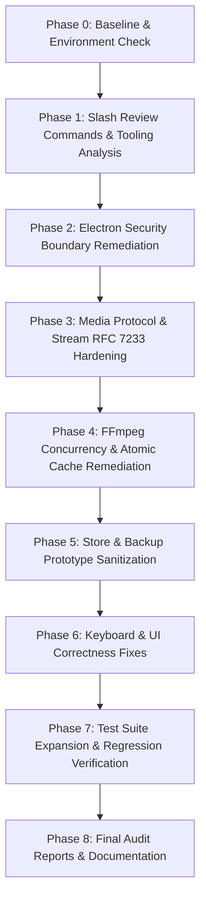

# SidPlayer — Complete Repository Audit, Security Review, and Remediation Plan

## 1. Project Overview & Context
- **Repository:** https://github.com/sakirhossn/SidPlayer
- **Project:** SidPlayer — Premium Local Video Player for Windows (v2.0.1)
- **Stack:** Electron 33, React 18, TypeScript 5.7, Vite 6, Vitest 2.1, Tailwind CSS 3.4, FFmpeg/FFprobe
- **Architecture:** Offline, local-first architecture. Media playback is piped through custom `media://` range-streaming protocol to Chromium HTML5 `<video>`, with on-demand MPEG-TS / HEVC / audio remuxing through FFmpeg.
- **Objective:** Complete security audit, correctness hardening, vulnerability remediation, regression testing, and auditable verification without breaking existing playback or user data.

---

## 2. High-Risk Modules
1. **`src/main/protocol.ts` (Critical Risk)**:
   Custom `media://` streaming protocol handler. Handles local file reads and HTTP Range headers (`RFC 7233`). Vulnerable to arbitrary local file disclosure (LFI) and stream leaks.
2. **`src/main/index.ts` (High Risk)**:
   Electron main lifecycle, privileged scheme registration, window creation, and IPC dispatch. Missing navigation barriers and child window restrictions.
3. **`src/main/store.ts` (High Risk)**:
   Atomic JSON database, settings, playlists, watch history, and backup import/export. Vulnerable to unbounded file reads and prototype pollution.
4. **`src/main/transmuxer.ts` (Medium Risk)**:
   Child process spawn for FFmpeg remuxing, video transcoding, audio track switching, and cache management. Vulnerable to cache corruption on abort.
5. **`src/main/mediaInfo.ts` & `src/main/thumbnails.ts` (Medium Risk)**:
   Child process execution for FFprobe and thumbnail generation, duplicate binary resolution paths.

---

## 3. Phase Dependencies & Execution Flow

---

## 4. Proposed Audit & Review Commands (Phase 1)
- `/gsd-code-review`: Structured code quality, bug, and vulnerability analysis.
- `/ponytail`: Audit repo against complexity and over-engineering principles.
- `/ponytail-gain`: Render benchmark median scorecards.
- `/ponytail-audit`: Scan repository tree for dead code, duplicated logic, and unnecessary abstractions.
- `/ponytail-review`: Line-level over-engineering and simplification review.

---

## 5. Detailed Remediation Plan

### Remediation Step 1: Electron Security Boundary & Protocol Authorization
- **Files:** `src/main/protocol.ts`, `src/main/index.ts`
- **Actions:**
  - Create an authorized media registry in `src/main/protocol.ts` (or query `store.getVideos()`, active temp cache, thumbnails, subtitles, and opened dialog files).
  - Strictly canonicalize requested paths (`path.resolve`) and deny requests for unauthorized paths (HTTP 403 Forbidden).
  - Remove `bypassCSP: true` from `protocol.registerSchemesAsPrivileged` in `src/main/index.ts`.
  - Add `mainWindow.webContents.setWindowOpenHandler(() => ({ action: 'deny' }))`.
  - Add `mainWindow.webContents.on('will-navigate', (event, url) => { if (!url.startsWith('http://localhost') && !url.startsWith('file://')) event.preventDefault() })`.

### Remediation Step 2: Stream Safety & RFC 7233 Compliance
- **Files:** `src/main/protocol.ts`
- **Actions:**
  - Rewrite range header parsing supporting full RFC 7233 specification:
    - Normal range: `bytes=0-1023`
    - Open-ended range: `bytes=1024-`
    - Suffix range: `bytes=-500` (last 500 bytes)
    - Zero-byte files: return 200 with Content-Length 0.
    - Invalid / unsatisfiable ranges: return 416 with `Content-Range: bytes */${fileSize}`.
  - Hook stream abort/cancel lifecycle to ensure underlying Node `fs.ReadStream` is destroyed immediately if the client disconnects or seeks.

### Remediation Step 3: Centralized Binary Discovery & Atomic Cache Safety
- **Files:** `src/main/binaries.ts` (new module), `src/main/transmuxer.ts`, `src/main/mediaInfo.ts`, `src/main/thumbnails.ts`
- **Actions:**
  - Create centralized `getFfmpegPath()` and `getFfprobePath()` that look in:
    1. `process.resourcesPath` / extraResources (for packaged builds)
    2. `C:\ffmpeg\bin\ffmpeg.exe` (Windows standard install)
    3. System PATH
  - In `switchAudioTrack` (`src/main/transmuxer.ts`), use a temp file (`${cachedPath}.tmp_${Date.now()}`) and atomically rename to `cachedPath` only upon clean completion.

### Remediation Step 4: Store & Backup Import Sanitization
- **Files:** `src/main/store.ts`
- **Actions:**
  - Limit backup file size to max 50MB before reading with `fs.statSync`.
  - Add recursive key sanitization stripping `__proto__`, `prototype`, and `constructor`.
  - Validate essential data shapes before committing changes.
  - Wrap backup restore in transactional state backup to ensure clean rollback if writing fails.

### Remediation Step 5: Keyboard Shortcut Fallback Integrity
- **Files:** `src/renderer/components/player/VideoPlayer.tsx`
- **Actions:**
  - Guard fallback keys (`' '`, `'k'`) so they only trigger if the key is not explicitly bound to another action in user's custom keybindings.

---

## 6. Expected Tests & Regression Suite
Create comprehensive unit tests in `tests/`:
1. `tests/protocolSecurity.test.ts`:
   - Validates RFC 7233 range parsing (normal, open-ended, suffix, zero-byte, invalid).
   - Validates unauthorized file access blocking (LFI prevention).
2. `tests/backupSanitizer.test.ts`:
   - Validates prototype pollution injection attempts are stripped (`__proto__`).
   - Validates oversized files are rejected.
3. `tests/binaries.test.ts`:
   - Validates binary resolution logic across environments.
4. Existing tests in `tests/`:
   - Verify all 25 existing tests continue to pass without regression.

---

## 7. Rollback Strategy
- All changes are tracked in Git on branch `main`.
- Clean commit checkpoints will be maintained.
- If any test or regression occurs, changes can be rolled back using `git checkout` on specific files without destructive side-effects.

---

## 8. Measurable Completion Criteria
1. Initial baseline and findings documented in `audit/INITIAL_BASELINE.md` and `audit/FINDINGS.md`.
2. All 5 requested review tools executed and consolidated.
3. 100% of confirmed vulnerabilities and defects remediated in source code.
4. New regression test suite passing in Vitest (`npm test`).
5. Zero TypeScript errors (`npx tsc --noEmit`).
6. Clean production build (`npm run build`).
7. Complete audit reports generated:
   - `audit/SECURITY_REVIEW.md`
   - `audit/TEST_REPORT.md`
   - `audit/REMEDIATION_LOG.md`
